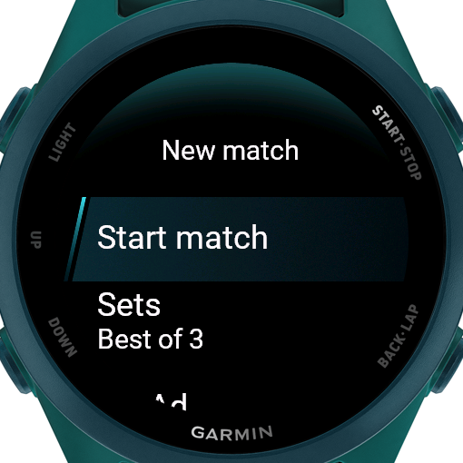
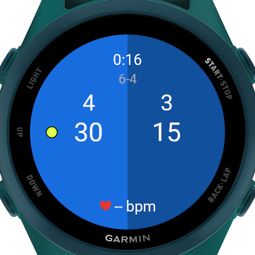
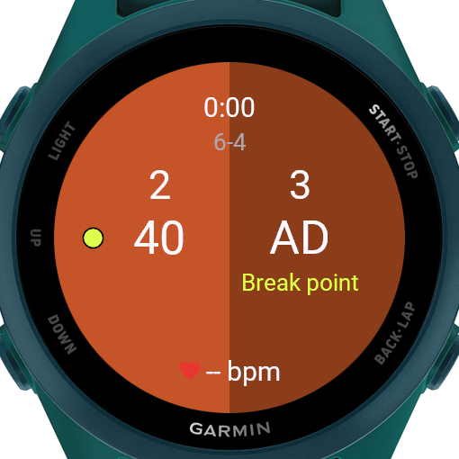
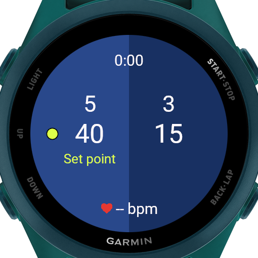
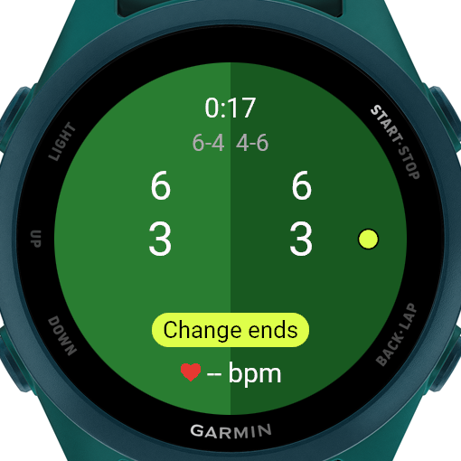
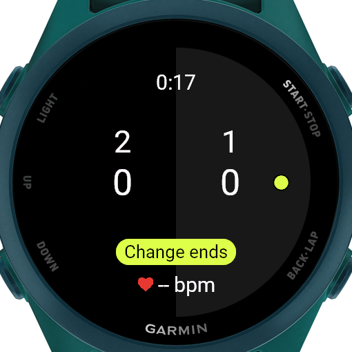
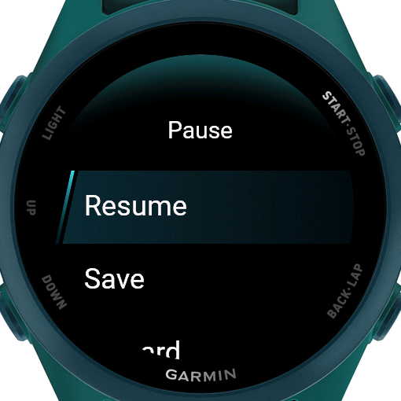
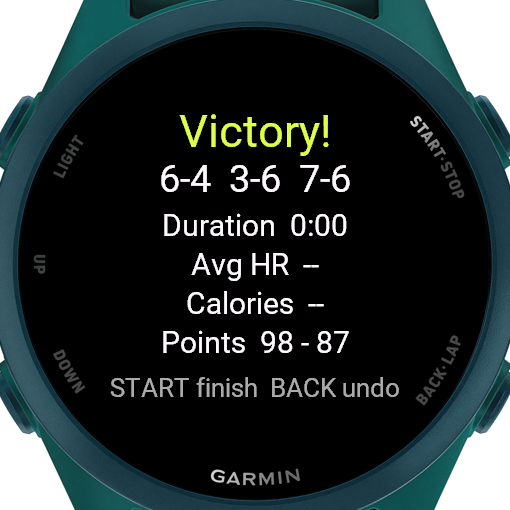

# TennisMatch

Eine Garmin-Connect-IQ-App für die Uhr, die beim Tennis den Spielstand zählt und das Match als Tennis-Aktivität in Garmin Connect speichert.

Entwickelt und getestet auf der **Forerunner 170 Music**, im Simulator und auf der echten Uhr. Das Manifest listet weitere aktuelle Garmin-Uhren.

## Screenshots

Die Bilder stammen aus dem Simulator, der auf Englisch eingestellt ist. Auf einer deutschsprachigen Uhr erscheinen alle Texte auf Deutsch.

| Setup | Im Match | Breakball | Satzball |
|:---:|:---:|:---:|:---:|
|  |  |  |  |
| **Tie-Break mit Seitenwechsel** | **Seitenwechsel** | **Pause** | **Zusammenfassung** |
|  |  |  |  |

## Funktionen

- **Zählen nach Tennisregeln:** 0/15/30/40, Einstand und Vorteil, Games, Sätze, Tie-Break bei 6:6
- **Geteilte Anzeige:** links der eigene Stand, rechts der des Gegners, jeweils mit Games und Punkten
- **Farb-Themes:** Klassisch (schwarz, akkuschonend auf AMOLED), Hartplatz Melbourne, Sand Paris, Rasen London, Hartplatz New York
- **Aufschlag-Anzeige:** ein neongelber Tennisball auf der Seite des Aufschlägers, auch im Tie-Break mit Wechsel alle zwei Punkte
- **Hinweise im Spiel:** Breakball, Satzball, Matchball, (Match-)Tie-Break und Seitenwechsel (nach ungeraden Games, im Tie-Break alle 6 Punkte)
- **Satzverlauf** oben auf dem Bildschirm, z. B. `6-4  3-6`
- **Vibration:** kurz bei jedem Punkt, länger bei Game und Satz, eigenes Muster beim Seitenwechsel und am Matchende
- **Undo:** Jeder Punkt lässt sich zurücknehmen, auch über Game-, Satz- und Matchgrenzen hinweg
- **Einstellbare Regeln** vor jedem Match:
  - Best of 1, 3 oder 5
  - No-Ad (bei 40:40 entscheidet ein Punkt)
  - Match-Tie-Break bis 10 statt Entscheidungssatz
  - Wer zuerst aufschlägt
  - Theme
- **Aufzeichnung als Tennis-Aktivität:** Dauer, Herzfrequenz und Kalorien, eine Runde (Lap) pro Satz
- **Laufzeit und Herzfrequenz** live auf dem Bildschirm
- **Zusammenfassung nach dem Match:** Ergebnis pro Satz, Dauer, ⌀ Puls, Kalorien, gewonnene Punkte
- Regeln und Theme werden gespeichert, der Aufschläger wird vor jedem Match neu gewählt
- Deutsch und Englisch, je nach Spracheinstellung der Uhr

## Bedienung

| Taste / Geste | Funktion |
|---|---|
| **Hoch** oder **linke Hälfte antippen** | Punkt für mich |
| **Runter** oder **rechte Hälfte antippen** | Punkt für den Gegner |
| **Zurück** | Letzten Punkt rückgängig machen. Gibt es nichts zurückzunehmen, öffnet sich das Pausenmenü. |
| **Start** | Aufzeichnung pausieren, Pausenmenü öffnen: Fortsetzen / Speichern / Verwerfen |

Nach dem letzten Punkt erscheint die Zusammenfassung. **Start** öffnet dort Speichern/Verwerfen. **Zurück** nimmt den letzten Punkt zurück, falls er versehentlich vergeben wurde, und das Match läuft weiter.

Wischen nach oben oder unten wird während des Matches ignoriert, damit nicht versehentlich Punkte vergeben werden.

## Projektstruktur

```
source/
├── TennisMatchApp.mc         Einstieg: zeigt das Setup-Menü
├── SetupMenuDelegate.mc      Setup-Menü vor dem Match
├── TennisMatchView.mc        Spielansicht (geteilte Hälften, Ball, Hinweise, Puls)
├── TennisMatchDelegate.mc    Tasten, Antippen und Vibration während des Matches
├── PauseMenuDelegate.mc      Pausenmenü und Menü nach Matchende
├── SummaryView.mc            Zusammenfassung nach dem Match
├── Theme.mc                  Farb-Themes, Übersetzungen, Formatierung
├── model/
│   ├── MatchRules.mc         Regeln und Theme, speichern/laden
│   └── MatchState.mc         Spielstand und Tennislogik inkl. Undo, Satzverlauf,
│                             Seitenwechsel und Break-/Satz-/Matchball
├── recording/
│   └── MatchRecorder.mc      Aufzeichnung über ActivityRecording
└── test/
    └── MatchStateTest.mc     Unit-Tests für die Zähllogik (35 Tests)

resources/                    Englische Texte (Standard), Icons
resources-deu/                Deutsche Texte
```

Die Tennislogik in `MatchState` ist unabhängig von Anzeige und Aufzeichnung und vollständig durch Unit-Tests abgedeckt.

## Entwicklung

### Voraussetzungen

- [Visual Studio Code](https://code.visualstudio.com/) mit der Extension **Monkey C** von Garmin
- [Connect IQ SDK](https://developer.garmin.com/connect-iq/sdk/) (über den SDK Manager), mindestens Version 9.2.0, und das Gerät *Forerunner 170 Music*
- Ein eigener Developer Key (`Monkey C: Generate a Developer Key` in VS Code)

> Der Developer Key gehört **nicht** ins Repository. Er ist in der `.gitignore` eingetragen und sollte außerhalb des Projektordners liegen.

### Im Simulator starten

1. Projektordner in VS Code öffnen
2. Eine `.mc`-Datei öffnen und `F5` drücken
3. Als Gerät `fr170m` wählen

### Tests ausführen

In VS Code links das Testing-Symbol (Reagenzglas) öffnen und alle Tests starten. Alternativ über die Kommandozeile:

```bash
# mit Tests kompilieren
monkeyc -f monkey.jungle -d fr170m -y <pfad/zum/developer_key> -o bin/test.prg --unit-test
# Simulator starten (connectiq), dann:
monkeydo bin/test.prg fr170m /t
```

### Auf die Uhr übertragen

1. In VS Code `Monkey C: Build for Device` ausführen und `fr170m` wählen
2. Die Uhr per USB anschließen
3. Die erzeugte `TennisMatch.prg` nach `GARMIN/APPS` auf der Uhr kopieren
   - Windows: über den Explorer
   - macOS: mit einem MTP-Programm wie [OpenMTP](https://openmtp.ganeshrvel.com/), da der Finder die Uhr nicht anzeigt
4. Uhr trennen. Die App erscheint in der App-Liste.

Bei Abstürzen auf der Uhr steht die Fehlermeldung in `GARMIN/APPS/LOGS/`.

## Roadmap

- [x] Test auf der echten Uhr
- [x] Geteiltes Layout mit Farb-Themes und Tennisball als Aufschlag-Anzeige
- [x] Punkte durch Antippen der linken/rechten Bildschirmhälfte, Vibration bei Punkt, Game und Satz
- [x] Hinweis auf den Seitenwechsel, Satzverlauf, Anzeige von Breakball/Satzball/Matchball
- [x] Zusammenfassung nach dem Match
- [x] Theme-Auswahl im Setup, eigenes App-Icon, Deutsch und Englisch

Mögliche nächste Ideen: Doppel mit Aufschlagreihenfolge über vier Spieler, Statistiken wie Asse und Doppelfehler, Endergebnis als eigenes Feld in Garmin Connect.
