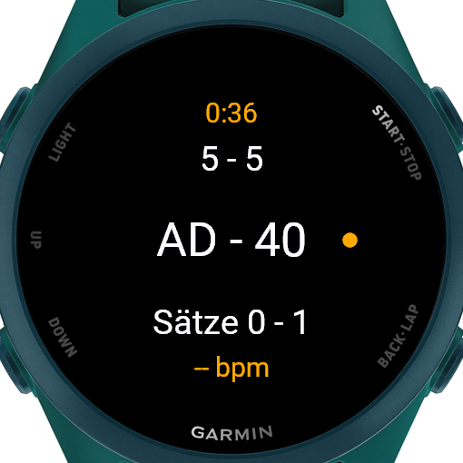
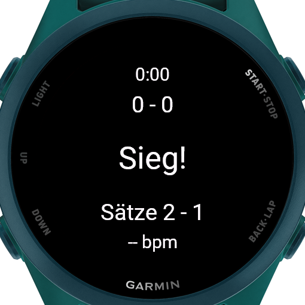

# TennisMatch

Eine Garmin-Connect-IQ-App für die Uhr, die beim Tennis den Spielstand zählt und das Match als Tennis-Aktivität in Garmin Connect speichert.

Entwickelt und getestet auf der **Forerunner 170 Music**. Das Manifest listet weitere aktuelle Garmin-Uhren.

## Screenshots

| Setup | Im Match | Vorteil |
|:---:|:---:|:---:|
|  |  |  |
| **Tie-Break** | **Pause** | **Matchende** |
|  |  |  |

## Funktionen

- **Zählen nach Tennisregeln:** 0/15/30/40, Einstand und Vorteil, Games, Sätze, Tie-Break bei 6:6
- **Aufschlag-Anzeige:** Ein gelber Punkt zeigt, wer aufschlägt, auch im Tie-Break mit Wechsel alle zwei Punkte
- **Undo:** Jeder Punkt lässt sich zurücknehmen, auch über Game-, Satz- und Matchgrenzen hinweg
- **Einstellbare Regeln** vor jedem Match:
  - Best of 1, 3 oder 5
  - No-Ad (bei 40:40 entscheidet ein Punkt)
  - Match-Tie-Break bis 10 statt Entscheidungssatz
  - Wer zuerst aufschlägt
- **Aufzeichnung als Tennis-Aktivität:** Dauer, Herzfrequenz und Kalorien, eine Runde (Lap) pro Satz
- **Laufzeit und Herzfrequenz** live auf dem Bildschirm
- Die zuletzt gewählten Regeln werden gespeichert

## Bedienung

| Taste | Funktion |
|---|---|
| **Hoch** | Punkt für mich |
| **Runter** | Punkt für den Gegner |
| **Zurück** | Letzten Punkt rückgängig machen. Gibt es nichts zurückzunehmen, öffnet sich das Pausenmenü. |
| **Start** | Aufzeichnung pausieren, Pausenmenü öffnen: Fortsetzen / Speichern / Verwerfen |

Links auf dem Bildschirm steht der eigene Stand, rechts der des Gegners.

## Projektstruktur

```
source/
├── TennisMatchApp.mc         Einstieg: zeigt das Setup-Menü
├── SetupMenuDelegate.mc      Setup-Menü vor dem Match
├── TennisMatchView.mc        Spielansicht
├── TennisMatchDelegate.mc    Tasten während des Matches
├── PauseMenuDelegate.mc      Pausenmenü
├── model/
│   ├── MatchRules.mc         Regeln (Sätze, No-Ad, Match-Tie-Break, Aufschlag), speichern/laden
│   └── MatchState.mc         Spielstand und Tennislogik inkl. Undo
├── recording/
│   └── MatchRecorder.mc      Aufzeichnung über ActivityRecording
└── test/
    └── MatchStateTest.mc     Unit-Tests für die Zähllogik
```

Die Tennislogik in `MatchState` ist unabhängig von Anzeige und Aufzeichnung und vollständig durch Unit-Tests abgedeckt.

## Entwicklung

### Voraussetzungen

- [Visual Studio Code](https://code.visualstudio.com/) mit der Extension **Monkey C** von Garmin
- [Connect IQ SDK](https://developer.garmin.com/connect-iq/sdk/) (über den SDK Manager), mindestens Version 9.2.0, und das Gerät *Forerunner 170 Music*
- Ein eigener Developer Key (`Monkey C: Generate a Developer Key` in VS Code)

> Der Developer Key gehört **nicht** ins Repository. Er ist in der `.gitignore` eingetragen und sollte außerhalb des Projektordners liegen.

### Im Simulator starten

1. Projektordner in VS Code öffnen
2. Eine `.mc`-Datei öffnen und `F5` drücken
3. Als Gerät `fr170m` wählen

### Tests ausführen

In VS Code links das Testing-Symbol (Reagenzglas) öffnen und alle Tests starten. Alternativ über die Kommandozeile:

```bash
# mit Tests kompilieren
monkeyc -f monkey.jungle -d fr170m -y <pfad/zum/developer_key> -o bin/test.prg --unit-test
# Simulator starten (connectiq), dann:
monkeydo bin/test.prg fr170m /t
```

### Auf die Uhr übertragen

1. In VS Code `Monkey C: Build for Device` ausführen und `fr170m` wählen
2. Die Uhr per USB anschließen
3. Die erzeugte `TennisMatch.prg` nach `GARMIN/APPS` auf der Uhr kopieren
   - Windows: über den Explorer
   - macOS: mit einem MTP-Programm wie [OpenMTP](https://openmtp.ganeshrvel.com/), da der Finder die Uhr nicht anzeigt
4. Uhr trennen. Die App erscheint in der App-Liste.

Bei Abstürzen auf der Uhr steht die Fehlermeldung in `GARMIN/APPS/LOGS/`.

